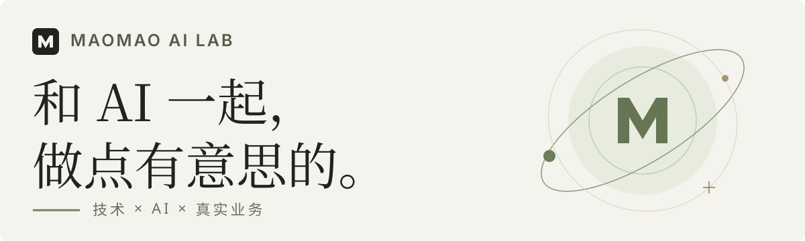

<a href="https://maomaolab.cn/">
  <picture>
    <source media="(prefers-color-scheme: dark)" srcset="assets/hello-dark.svg">
    <source media="(prefers-color-scheme: light)" srcset="assets/hello-light.svg">
    
  </picture>
</a>

我是 **毛毛**，从企业业务到个人兴趣，探索 AI 能做什么，并把它做出来。

**10+ 年企业系统与架构实践** · AI Agent 与自动化 · 实用工具与交互实验

  <a href="https://maomaolab.cn/">个人网站 ↗</a> &nbsp; / &nbsp;
  <a href="https://maomaolab.cn/projects/">全部作品</a> &nbsp; / &nbsp;
  <a href="https://maomaolab.cn/news/">AI 今日精选</a> &nbsp; / &nbsp;
  <a href="https://maomaoailab.com/">English</a>

## 精选作品

<table>
  <tr>
    <td width="50%" valign="top">
      
      <h3>毛毛的实验星球</h3>
      
把作品集做成一颗可以散步的小星球。发现作品，收集小纪念。

      
3D 互动 · 浏览器体验

      <a href="https://maomaolab.cn/apps/maomao-planet/">探索星球 →</a>
    </td>
    <td width="50%" valign="top">
      
      <h3>LiveForge</h3>
      
在浏览器本地，将图片与视频批量制作成 Live Photo 素材。

      
创作工具 · 本地处理

      <a href="https://maomaolab.cn/tools/liveforge/">了解工具 →</a>
    </td>
  </tr>
  <tr>
    <td width="50%" valign="top">
      <h3>ai-memory</h3>
      
记录 → 同步 → 继续。跨电脑保存有来源的项目状态，让下一次工作接着进行。

      
协作记忆 · 工程实践

      <a href="https://maomaolab.cn/projects/ai-memory/">查看实践 →</a>
    </td>
    <td width="50%" valign="top">
      <h3>采购 AI 专题</h3>
      
从需求抽取、行情洞察到供应商候选，让 AI 进入采购人员的确认流程。

      
企业场景 · 人工确认

      <a href="https://maomaolab.cn/projects/procurement-ai/">查看案例 →</a>
    </td>
  </tr>
</table>

## 也在这里做开源

- **[WebStack-Guns](https://github.com/jsnjfz/WebStack-Guns)** — 基于 Guns 与 Spring Boot 的开源网址导航。
- **[Codex Reset Radar](https://github.com/jsnjfz/codex-reset-radar)** — 关注公开动态，通过 macOS 菜单栏工具接收 AI 用量重置线索。

在真实的业务场景中，把技术、产品和 AI 连接起来。 · <a href="https://maomaolab.cn/">Maomao AI Lab ↗</a>
